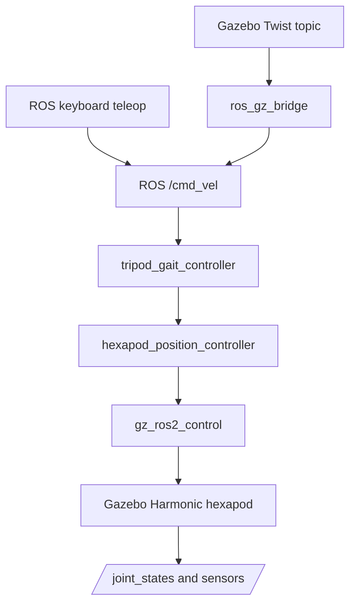
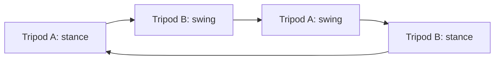
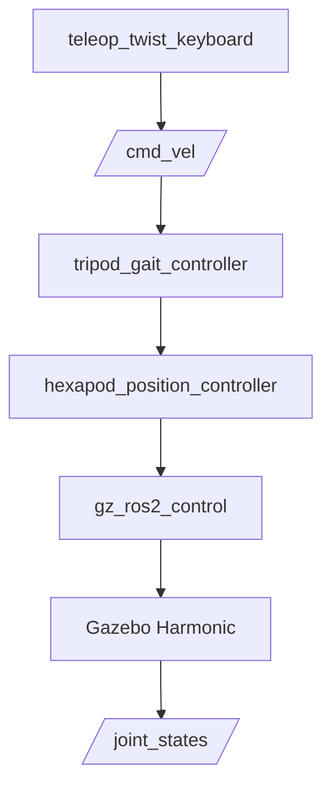

# Hexapod Simulation 🕷️

An **18-DOF hexapod simulation** built with **ROS 2 Jazzy** and **Gazebo Harmonic**. It uses a joint-space alternating tripod gait and accepts velocity commands through ROS 2 or a Gazebo-to-ROS bridge.

> **Status:** Teleoperation and omnidirectional movement require testing on the running Gazebo simulation. The commands below describe the intended interfaces; they do not guarantee that the current joint-space gait can physically strafe.

## Features

- Six legs with three joints each: **hip → knee → ankle**.
- Alternating tripod gait with two groups 180° out of phase.
- ROS 2 `/cmd_vel` input and optional Gazebo-native command bridging.
- Joint control through `gz_ros2_control`.
- RViz visualization and Gazebo sensor interfaces.

## System architecture



The gait controller converts commanded body velocity into an array of **18 joint-position targets**. `gz_ros2_control` applies those targets in Gazebo.

## Tripod gait

| Tripod A | Tripod B |
|---|---|
| L1 | R1 |
| R2 | L2 |
| L3 | R3 |



The two groups are phase-shifted by half a gait cycle. Each leg alternates between a supporting **stance** phase and a lifted **swing** phase.

## Requirements

- Ubuntu 24.04, ROS 2 Jazzy and Gazebo Harmonic
- `ros_gz_sim`, `ros_gz_bridge`, `gz_ros2_control`
- `robot_localization`, `controller_manager` and `colcon`
- Keyboard teleop dependencies required by the included teleop launch file

## How to run 🚀

The hexapod is controlled **only through `teleop_twist_keyboard`**. The keyboard node publishes standard ROS 2 `geometry_msgs/msg/Twist` messages to `/cmd_vel`, which are consumed by the tripod gait controller.

### 1. Install the keyboard teleoperation package

If it is not already installed:

```bash
sudo apt update
sudo apt install ros-jazzy-teleop-twist-keyboard
```

### 2. Build the workspace

```bash
cd ~/hexapod_simulation/ros2_ws
source /opt/ros/jazzy/setup.bash

rm -rf build install log
colcon build --symlink-install

source install/setup.bash
```

### 3. Launch the hexapod simulation

Start Gazebo, the robot, controllers, bridges, EKF and gait controller:

```bash
ros2 launch hexapod_description sim.launch.py
```

Wait until the hexapod has spawned and `hexapod_position_controller` is active.

### 4. Start `teleop_twist_keyboard`

Open a **second terminal** and source ROS 2 and the workspace:

```bash
source /opt/ros/jazzy/setup.bash
source ~/hexapod_simulation/ros2_ws/install/setup.bash

ros2 run teleop_twist_keyboard teleop_twist_keyboard
```

The standard `teleop_twist_keyboard` controls are: 

| Key | Command |
|---|---|
| `i` | Forward |
| `,` | Backward |
| `j` | Rotate left |
| `l` | Rotate right |
| `u` | Forward + rotate left |
| `o` | Forward + rotate right |
| `m` | Backward + rotate left |
| `.` | Backward + rotate right |
| `k` | Stop / zero velocity |
| `q` / `z` | Increase / decrease speed |

> **Important:** The standard `teleop_twist_keyboard` keymap does **not** provide dedicated `A/D` lateral/strafe keys. Its default diagonal keys combine forward/backward velocity with yaw. If true sideways motion using `linear.y` is required, the teleop keymap must be customized separately.

### 5. Verify `/cmd_vel`

In a third terminal:

```bash
source /opt/ros/jazzy/setup.bash
source ~/hexapod_simulation/ros2_ws/install/setup.bash

ros2 topic echo /cmd_vel
```

When pressing `i`, the message should contain a positive `linear.x`. When pressing `,`, it should contain a negative `linear.x`. The `j` and `l` keys should change `angular.z`.

### 6. Verify the controllers

```bash
ros2 node list
ros2 control list_controllers
ros2 topic echo /hexapod_position_controller/commands
ros2 topic echo /joint_states
```

Expected active controllers include:

```text
joint_state_broadcaster
hexapod_position_controller
```

The gait controller should convert each `/cmd_vel` command into an array containing **18 joint positions**.

### Control pipeline



The control path intentionally has **one teleoperation source**: `teleop_twist_keyboard`. Gazebo-native teleoperation and custom keyboard nodes are not required.

## Project structure

```text
hexapod_simulation/
├── README.md
├── assets/images/
└── ros2_ws/
    └── src/
        ├── hexapod_description/
        │   ├── config/       # Bridges and EKF
        │   ├── launch/       # Gazebo and RViz launch files
        │   ├── meshes/       # Robot CAD meshes
        │   ├── rviz/         # RViz configuration
        │   └── urdf/         # Xacro / URDF robot model
        └── hexapod_controller/
            ├── config/       # ros2_control configuration
            ├── launch/       # Controller startup
            └── hexapod_controller/
                └── gait_controller.py
```

## Key topics

| Topic | Purpose |
|---|---|
| `/cmd_vel` | Requested body velocity |
| `/hexapod_position_controller/commands` | 18 joint-position targets |
| `/joint_states` | Measured joint states |
| `/odom` | Odometry, when bridged |
| `/imu` | IMU, when bridged |
| `/scan` | LiDAR, when bridged |
| `/camera/image_raw` | Camera, when bridged |
| `/clock` | Simulation time |

## Troubleshooting

**Teleop does nothing:** Confirm that the keyboard terminal has focus, that `/cmd_vel` is receiving messages, and that no second publisher is overriding them. For Gazebo-native commands, inspect the configured bridge direction and topic names.

**Robot walks in the wrong direction:** Check `base_link` orientation, hip joint axes, left/right sign conventions and each foot's physical sweep direction. Rotating only the visual mesh does not correct the kinematic frame.

**Robot drags or circles:** Inspect swing-foot clearance, contact collisions, leg symmetry and joint-state tracking. A joint-space gait alone does not guarantee balanced ground forces or true sideways walking.

**Controllers fail to spawn:** Verify that Gazebo has spawned the robot and that the `gz_ros2_control` controller manager exists before starting the spawners.

## Next steps

For research-grade legged locomotion, add foot-space inverse kinematics, body attitude stabilization, contact estimation and closed-loop gait correction. These techniques also transfer directly to bipedal and humanoid locomotion research.
