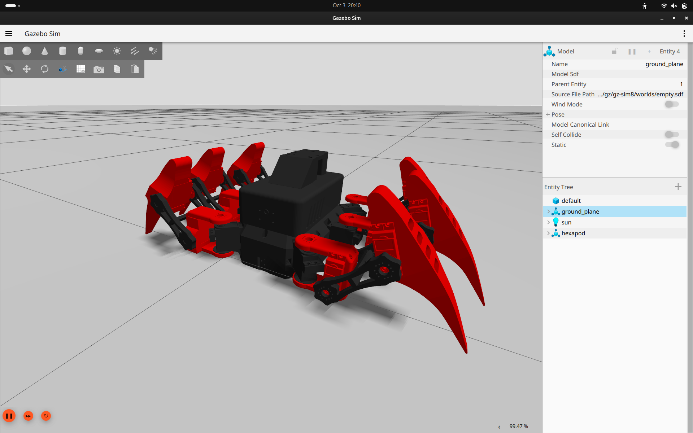
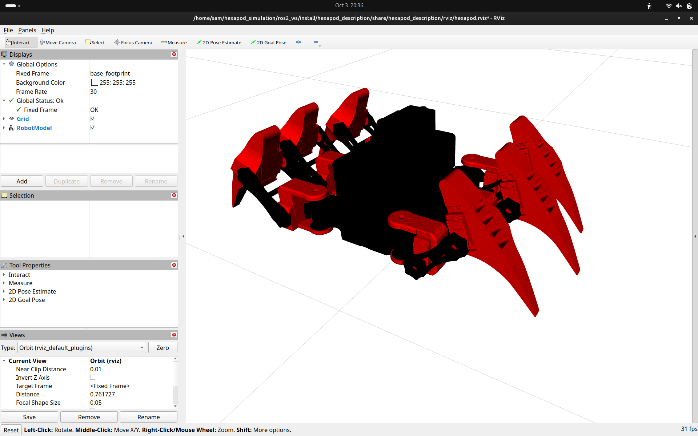

# Hexapod Simulation 🕷️

A ROS 2 and Gazebo simulation project for a six-legged robot, focused on **tripod gait locomotion, sensor integration, state estimation, SLAM, and navigation**.

**Maintainer:** [@sam-airobotics](https://github.com/sam-airobotics)  
**Target platform:** Ubuntu 24.04 LTS · ROS 2 Jazzy · Gazebo Harmonic

<p align="center">
  
</p>

<p align="center"><em>Hexapod model simulated in Gazebo Harmonic.</em></p>

---

## 📌 Project overview

This repository contains the robot description, simulation world, gait controller, sensor bridges, and navigation-related packages for a simulated **18-DOF hexapod** (six legs with three joints per leg). Velocity commands are received on ROS 2 `/cmd_vel` and converted into joint-position targets by a custom tripod gait controller.

The project is intended as a development base for experimenting with legged locomotion and autonomous robotics workflows in simulation.

## ✨ Features

- **18-DOF hexapod model** with a URDF/Xacro description and mesh assets.
- **Alternating tripod gait** controller with configurable gait parameters.
- **Velocity commands** through ROS 2 `/cmd_vel`.
- **ROS 2 control** using `ros2_control` and `gz_ros2_control`.
- **Gazebo Harmonic** simulation with a custom world/terrain model.
- **RViz2 visualization** for robot state and sensor inspection.
- **Sensor bridges** for LiDAR, camera, IMU, joint states, and simulation clock.
- **EKF state estimation** configuration using `robot_localization`.
- **SLAM** launch/configuration support through `slam_toolbox` and Cartographer.
- **Nav2** localization and navigation configuration.
- **Dependency installer** for the documented Ubuntu 24.04 / ROS 2 Jazzy setup.

## 🖥️ Visualization

### Gazebo simulation

Gazebo is used to simulate the hexapod, its world, joints, and simulated sensors.

<p align="center">
  
</p>

### RViz2 visualization

RViz2 provides a view of the robot description and ROS visualization data.

<p align="center">
  
</p>

---

## 🧰 Technology stack

| Component | Technology |
|---|---|
| Operating system | Ubuntu 24.04 LTS |
| Robotics middleware | ROS 2 Jazzy |
| Physics simulation | Gazebo Harmonic |
| Robot description | URDF / Xacro |
| Robot control | `ros2_control`, `gz_ros2_control` |
| Visualization | RViz2 |
| State estimation | `robot_localization` (EKF) |
| SLAM | `slam_toolbox`, Cartographer launch support |
| Navigation | Nav2 configuration |

> **Compatibility note:** The supplied installer explicitly checks for Ubuntu 24.04 and installs ROS 2 Jazzy packages. Ubuntu 22.04 / ROS 2 Humble is not the target configuration for the current installer.

## 🏗️ Repository structure

```text
hexapod_simulation/
├── assets/
│   └── images/
│       ├── hexapod_gazebo.png
│       └── hexapod_rviz.png
├── install_dependencies.sh
└── ros2_ws/
    └── src/
        ├── hexapod_description/
        │   ├── config/          # Bridge and EKF configuration
        │   ├── launch/          # Simulation, display, teleop launch files
        │   ├── meshes/          # Robot geometry
        │   ├── rviz/            # RViz configuration
        │   ├── scripts/         # Gazebo teleoperation helper
        │   ├── urdf/            # URDF/Xacro model
        │   └── world/           # SDF world and terrain mesh
        ├── hexapod_controller/
        │   ├── config/          # Controller configuration
        │   └── hexapod_controller/
        │       ├── gait_controller.py
        │       └── teleop.py
        ├── hexapod_slam/
        │   ├── config/
        │   └── launch/
        └── hexapod_nav/
            ├── config/
            └── launch/
```

---

## 🚀 Installation

### 1. Clone the repository

```bash
git clone https://github.com/sam-airobotics/hexapod_simulation.git
cd hexapod_simulation
```

### 2. Install dependencies

The repository provides an installer at the project root. Review the script before running it, since it installs system packages and edits your shell configuration.

```bash
chmod +x install_dependencies.sh
./install_dependencies.sh
```

The installer is designed for Ubuntu 24.04 LTS and installs ROS 2 Jazzy, Gazebo Harmonic integration, control packages, sensor/message packages, SLAM/navigation dependencies, and build tools. It also updates `~/.bashrc` with the project environment.

Reload the shell configuration:

```bash
source ~/.bashrc
```

### 3. Build the ROS 2 workspace

```bash
cd ~/hexapod_simulation/ros2_ws
colcon build --symlink-install
source install/setup.bash
```

If you are rebuilding after changing packages or generated files, you can clean build outputs first:

```bash
rm -rf build install log
colcon build --symlink-install
source install/setup.bash
```

Verify that the packages are discoverable:

```bash
ros2 pkg list | grep hexapod
```

The workspace contains the following project packages:

- `hexapod_description`
- `hexapod_controller`
- `hexapod_slam`
- `hexapod_nav`

---

## ▶️ Run the simulation

After the workspace builds successfully, launch the simulation:

```bash
source /opt/ros/jazzy/setup.bash
source ~/hexapod_simulation/ros2_ws/install/setup.bash
ros2 launch hexapod_description sim.launch.py
```

The launch file is configured to start Gazebo, spawn the hexapod, launch the ROS–Gazebo bridge and RViz2, start the EKF node, and spawn the configured controllers.

To view only the robot model in RViz2 (without the full Gazebo simulation), use:

```bash
ros2 launch hexapod_description display.launch.py
```

## 🎮 Teleoperation

Open a **new terminal** and source the environment:

```bash
source /opt/ros/jazzy/setup.bash
source ~/hexapod_simulation/ros2_ws/install/setup.bash
```

Start the standard keyboard teleoperation node:

```bash
ros2 run teleop_twist_keyboard teleop_twist_keyboard
```

The default `teleop_twist_keyboard` key mapping includes:

| Key | Action |
|---|---|
| `i` | Forward |
| `,` | Backward |
| `j` | Rotate left |
| `l` | Rotate right |
| `u` / `o` | Forward with left / right rotation |
| `m` / `.` | Backward with left / right rotation |
| `k` | Stop |
| `q` / `z` | Increase / decrease speed |

The custom tripod gait controller subscribes to `/cmd_vel` and publishes joint-position targets to `/hexapod_position_controller/commands`.

A project helper script is also available at `ros2_ws/src/hexapod_description/scripts/gazebo_teleop.sh`; consult the script's usage and bridge configuration before using it.

## 🔎 Useful ROS 2 checks

List active nodes:

```bash
ros2 node list
```

Inspect available topics:

```bash
ros2 topic list
```

Check incoming velocity commands:

```bash
ros2 topic echo /cmd_vel
```

Check gait-controller joint commands:

```bash
ros2 topic echo /hexapod_position_controller/commands
```

Check controller state:

```bash
ros2 control list_controllers
```

Topics configured by the simulation include:

| Topic | Purpose |
|---|---|
| `/clock` | Simulation time |
| `/cmd_vel` | Body velocity command |
| `/joint_states` | Joint feedback |
| `/scan` | LiDAR scan |
| `/camera/image_raw` | Camera image |
| `/imu` | IMU data |
| `/odom` | State-estimation/odometry output |
| `/tf`, `/tf_static` | Coordinate transforms |

Actual topic availability depends on which launch files and nodes are running.

---

## 🧭 SLAM and navigation

### SLAM Toolbox

```bash
ros2 launch hexapod_slam online_async_launch.py
```

The configuration is stored at:

```text
ros2_ws/src/hexapod_slam/config/mapper_params_online_async.yaml
```

### Cartographer

A Cartographer launch file is included:

```bash
ros2 launch hexapod_slam cartographer.launch.py
```

Check the launch file's package-share paths and configuration before using it; the repository may contain legacy references that need to be aligned with the current package name.

### Nav2

Navigation and localization launch files are in `ros2_ws/src/hexapod_nav/launch/`:

```bash
ros2 launch hexapod_nav localization_launch.py
ros2 launch hexapod_nav navigation_launch.py
```

Run localization/navigation only after the simulation, required transforms, sensor topics, map, and odometry are configured and verified.

---

## ⚙️ How the control pipeline works

```mermaid
flowchart TD
    A[Teleoperation / velocity source] --> B[/cmd_vel]
    B --> C[Tripod gait controller]
    C --> D[/hexapod_position_controller/commands]
    D --> E[ros2_control + gz_ros2_control]
    E --> F[Gazebo Harmonic]
    F --> G[Simulated sensors and joint feedback]
    G --> H[ROS-Gazebo bridge]
    H --> I[EKF / SLAM / Nav2]
```

The current gait controller is a **joint-space tripod-gait implementation**. It maps body-velocity commands into hip, knee, and ankle position targets; it is not yet a complete foot-space inverse-kinematics or force-controlled locomotion stack.

## 🛠️ Troubleshooting

**ROS packages are not found**

```bash
source /opt/ros/jazzy/setup.bash
source ~/hexapod_simulation/ros2_ws/install/setup.bash
ros2 pkg list | grep hexapod
```

**Gazebo cannot find the custom world/terrain**

Check the resource path configured by the installer and confirm the world assets exist:

```bash
echo "$GZ_SIM_RESOURCE_PATH"
ls ~/hexapod_simulation/ros2_ws/src/hexapod_description/world
ls ~/hexapod_simulation/ros2_ws/src/hexapod_description/world/meshes
```

**The robot does not respond to `/cmd_vel`**

Check each stage of the pipeline:

```bash
ros2 topic echo /cmd_vel
ros2 topic echo /hexapod_position_controller/commands
ros2 control list_controllers
```

Confirm that the gait controller and `hexapod_position_controller` are running, then inspect terminal logs for controller-manager or bridge errors.

**The robot drifts, rotates unexpectedly, or drags its body**

A joint-space gait does not provide full body stabilization or foot-contact control. Gait timing, joint neutral positions, coordinate-frame conventions, contact/friction settings, and robot geometry can all affect the resulting motion. Treat these as simulation limitations to investigate rather than assuming that command input alone guarantees accurate walking.

---

## 🔬 Future work

Potential next steps for improving locomotion quality and research value:

- Foot trajectory generation and inverse kinematics.
- Ground-contact detection and stance/swing phase management.
- IMU-based body stabilization and closed-loop feedback.
- Gait tuning and performance evaluation across different terrains.
- Integration testing for SLAM and Nav2 with the legged base.

These areas connect directly to **legged bionics and humanoid locomotion research**: robust contact handling, balance, feedback control, and coordinated leg trajectories are important foundations for more advanced legged robots.

## 📄 License

No license file was confirmed during this README update. Add a `LICENSE` file to specify how others may use, modify, and redistribute this project.

---

<p align="center">
  Built for robotics simulation, controls development, and legged-locomotion experiments.
</p>
